<div align="center">

# Wind Edge Chip

**One-hour-ahead wind-turbine power forecasting on a low-power custom FPGA accelerator, running at the turbine**

Estiyanti Ekawati<sup>1</sup> · Shania Argiliana<sup>1</sup> · Izma Alhazmi Herdian<sup>1</sup> · Genis Gusvian Hartanto<sup>2</sup> · Alif Muhammad Rizky<sup>1</sup>

<sup>1</sup>Institut Teknologi Bandung · <sup>2</sup>Pusat Teknologi Instrumentasi dan Otomasi (PTIO) ITB

Team Chitato · DeepTech for Smart-X Hackathon 2026, Renewable Energy track (Wind Power Output Forecasting)

[](http://citaitb.com:1880/dashboard/hackathon)
[](docs/laporan-progress/2026-10-22-machine-learning.pdf)
[](docs/presentasi/hackathon-2026/demo-day/demoday.pdf)
[](hw/)
[](edge/esp32/)
[](ml/forecast/)

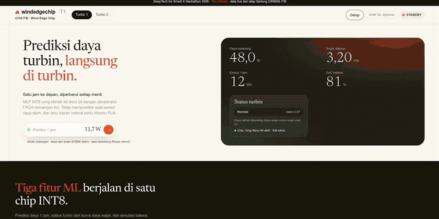

</div>

## Highlights

| | |
|---|---|
| 🎯 **Forecast** | Mean turbine power over the next 60 min, refreshed every minute. Test MAE **5.48 W** vs. persistence 8.67 W (−37 %) |
| 🧮 **Tiny model** | MLP 16-32-16-1, INT8 with quantisation-aware training; 1,040 weights + 49 biases |
| 🔩 **Custom chip** | 4-lane MAC accelerator on a Gowin GW1NSR-4C (Tang Nano 4K), driven by an ESP32-S3 over UART (CRC-8, 921,600 bps), **309 cycles** per prediction |
| ✅ **Bit-exact** | Hardware-in-the-loop: **5,373 / 5,373** inferences identical to the golden model |
| ⚡ **Energy** | ≈ **17×** less energy per prediction than a Raspberry Pi (10.4 J vs. 182 J, INA219 estimate) |
| 🌬️ **Real plant** | Live on a 1 kW turbine on the CRIMSE building roof, ITB. Trained on 181,228 minutes of real data |
| 🛟 **Robust** | Fallback modes for a silent power sensor, data gaps, lost internet and a Raspberry Pi reboot |

## Paper & links

| | |
|---|---|
| 📄 ML report (method, results, QnA) | [`docs/laporan-progress/2026-10-22-machine-learning.pdf`](docs/laporan-progress/2026-10-22-machine-learning.pdf) |
| 📄 System progress report + user guide | [`docs/laporan-progress/2026-10-20.pdf`](docs/laporan-progress/2026-10-20.pdf) |
| 📄 FPGA acceleration study | [`hw/docs/riset_akselerasi_fpga.pdf`](hw/docs/riset_akselerasi_fpga.pdf) |
| 🖥️ Demo Day deck | [`demoday.pdf`](docs/presentasi/hackathon-2026/demo-day/demoday.pdf) · [Beamer deck](docs/presentasi/hackathon-2026/main.pdf) |
| 🌐 Live dashboard | <http://citaitb.com:1880/dashboard/hackathon> |
| 🧪 Demo runbook | [`docs/demo/runbook.md`](docs/demo/runbook.md) |

## Demo

<table>
<tr>
<td align="center" width="50%">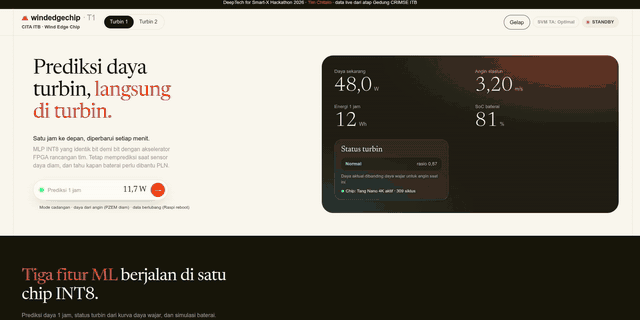<br/><b>Dashboard tour</b> (100 s screencast, 4× speed)</td>
<td align="center" width="50%">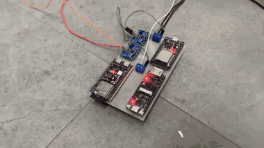<br/><b>Edge board in the plant</b>: ESP32-S3 + Tang Nano 4K + 2× INA219</td>
</tr>
<tr>
<td align="center"><br/><b>Dashboard highlight</b> (20 s clip used in the deck)</td>
<td align="center">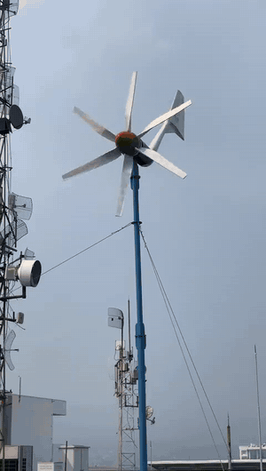<br/><b>The turbine</b> on the CRIMSE roof, ITB</td>
</tr>
</table>

<sub>The source MP4s are not kept in the repo because they are too large.</sub>

### Key moments

| Landing: forecast from the chip | CCTV + 3D digital twin | Power: Raspberry Pi vs. FPGA |
|:---:|:---:|:---:|
| 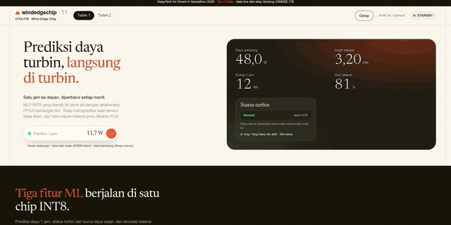 | 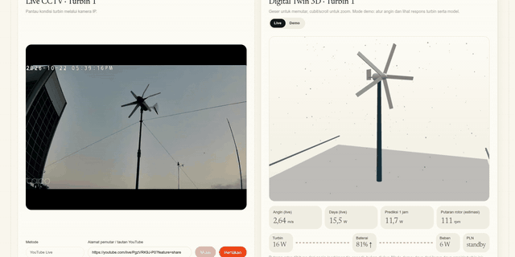 | 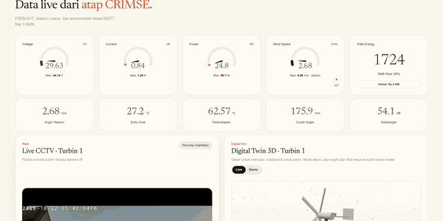 |
| 1 h forecast, turbine status, battery SoC | Live camera next to the twin, driven by the same MQTT data | INA219 readings: 2.90 W vs. 0.16 W at that moment |

## Method

<p align="center">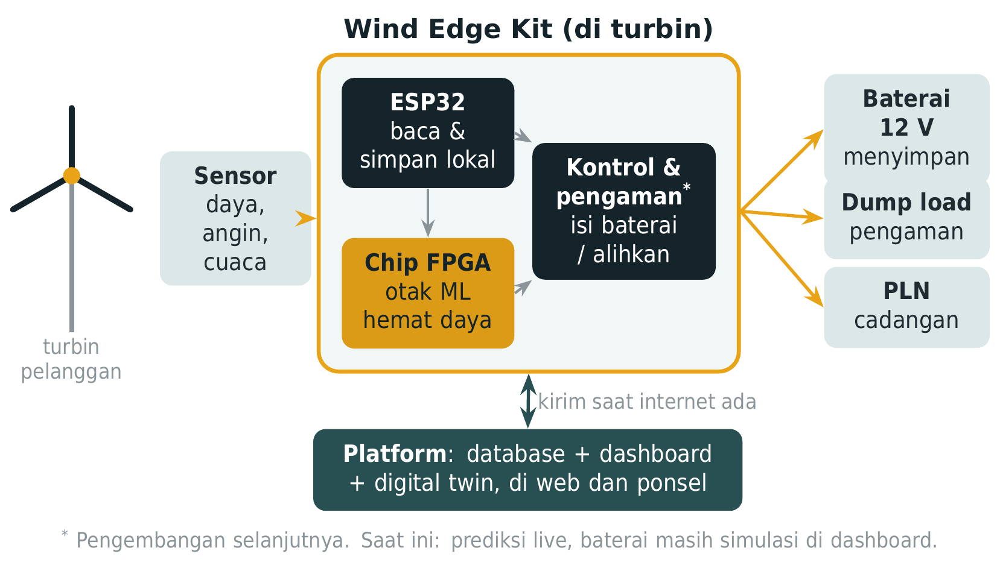</p>

1. **Sensing.** A PZEM-017 meter (power, V, I) and a weather station (wind speed and direction, temperature, humidity) are read every few seconds and published over MQTT. The Raspberry Pi pipeline comes from the original TA (final-project) system; the ESP32-S3 firmware in `edge/esp32/` can replace it.
2. **Features.** Data is aggregated per minute into **16 features** (recent power and wind statistics, time of day, Open-Meteo wind forecast) ([`ml/forecast/features.py`](ml/forecast/features.py)). The data is split by time: train ≤ July, validation Aug–Sep, test 1–20 Oct 2026.
3. **Model.** A 16-32-16-1 MLP is trained with INT8 quantisation-aware training that mimics the chip arithmetic exactly ([`train_mlp.py`](ml/forecast/train_mlp.py)). The scale contract is in [`docs/kontrak-kuantisasi.md`](docs/kontrak-kuantisasi.md).
4. **Accelerator.** Verilog RTL ([`hw/rtl/`](hw/rtl/)) has a 4-lane MAC engine, an FSM controller, a weight ROM, post-processing and a UART framed with CRC-8 ([`docs/kontrak-uart.md`](docs/kontrak-uart.md)). The bitstream is stored in the GW1NSR-4C internal flash, so the model survives a power cycle.
5. **Integration.** The ESP32-S3 bridges MQTT and the FPGA. The Node-RED engine ([`dashboard/wec/`](dashboard/wec/)) runs the same INT8 weights plus turbine-status and battery tasks, and InfluxDB stores the history.

<p align="center">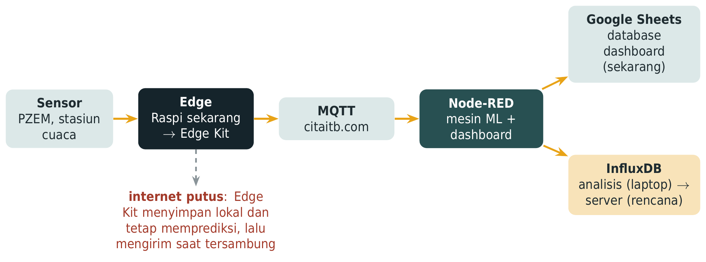</p>

## Results

All numbers come from `ml/results/*.json|csv`, `docs/demo/hil-2026-10-21.txt`, `measurements/results/` and the checked list in [`cek-angka.md`](docs/presentasi/hackathon-2026/demo-day/cek-angka.md).

### Forecast accuracy (test set 1–20 Oct 2026, 60-min-ahead mean power)

| Method | Group | MAE (W) | RMSE (W) | Skill vs. persistence | MAC / prediction | Runs on FPGA |
|---|---|---:|---:|---:|---:|:---:|
| Transformer (60-min history) | Sequential NN | 5.70 | **10.07** | 0.411 | – | hard |
| Linear regression | Linear | 5.71 | 10.23 | 0.402 | 16 | ✅ |
| TCN (60-min history) | Sequential NN | 5.46 | 10.25 | 0.401 | – | maybe |
| **MLP INT8 (QAT, bit-exact with RTL)** | **Hardware INT8** | **5.48** | 10.25 | 0.401 | 1,040 | ✅ |
| LSTM (60-min history) | Sequential NN | 5.59 | 10.35 | 0.395 | – | hard |
| GRU (60-min history) | Sequential NN | 5.54 | 10.41 | 0.392 | – | hard |
| MLP float 16-32-16-1 | Tabular NN | 5.62 | 10.47 | 0.388 | 1,040 | ✅ |
| ExtraTrees | Trees | 5.46 | 10.59 | 0.382 | – | ❌ |
| MLP INT8 (PTQ, no QAT) | Hardware INT8 | 6.75 | 10.65 | 0.378 | 1,040 | ✅ |

<sub>Excerpt from [`ml/results/benchmark.csv`](ml/results/benchmark.csv) (36 methods in total).</sub>

| Baseline (test set) | MAE (W) | RMSE (W) | Skill |
|---|---:|---:|---:|
| Persistence (current P) | 8.67 | 17.11 | 0.000 |
| Moving average, 10 min | 7.47 | 14.39 | 0.159 |
| Smart persistence (mean of last 60 min) | 7.12 | 12.62 | 0.262 |
| Hourly climatology | 6.85 | 12.89 | 0.247 |
| Blend mean60 + climatology (α = 0.35) | 5.91 | 11.00 | 0.357 |

<sub>From [`ml/results/baselines.json`](ml/results/baselines.json).</sub>

<table>
<tr>
<td width="50%">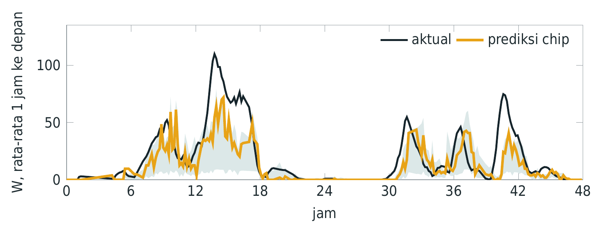<br/><sub>48 h of test data: actual (black) vs. chip forecast (orange).</sub></td>
<td width="50%">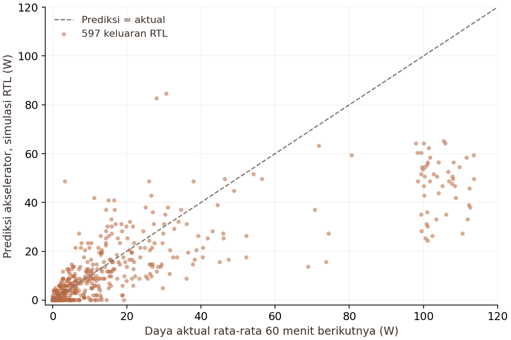<br/><sub>597 RTL-simulation outputs vs. actual next-60-min mean power.</sub></td>
</tr>
</table>

### Robustness ([`dashboard/wec/test/`](dashboard/wec/test/))

| Scenario | Minutes tested | Result |
|---|---:|---|
| Power sensor silent (no PZEM) | 20,997 | MAE 5.14 W vs. 5.07 W normal |
| 20 % of data randomly missing | 20,783 | 97.7 % coverage, MAE 5.07 W vs. 5.00 W |
| Raspberry Pi reboots caused by lost internet (Apr–Oct) | – | 2,787 events, handled by recovery mode |

### Hardware verification

| Check | Result | Source |
|---|---|---|
| HIL ESP32-S3 ↔ Tang Nano 4K | 9 rounds × 597 = **5,373 / 5,373 identical**, 0 retries | [`hil-2026-10-21.txt`](docs/demo/hil-2026-10-21.txt) |
| FPGA cycles per prediction | 309 | same |
| UART round trip (HIL) | mean 482.2 µs, max 494 µs | same |
| Internal flash, after power cycle | 3/3 predictions match, CRC OK | [`flash-permanen-fpga.md`](docs/demo/flash-permanen-fpga.md) |
| Raspberry Pi C++ model | 597/597 vectors identical; median 3.231 µs compute | [`2026-10-21-summary.md`](measurements/results/2026-10-21-summary.md) |
| ESP32-S3 ↔ FPGA UART (controlled test) | median 562 µs | same |

### Energy and cost

| | Raspberry Pi (current TA system) | ESP32-S3 + FPGA (this work) |
|---|---:|---:|
| Average power (INA219, 22 Oct) | 2.96 W | 0.17 W |
| Energy per prediction | 182 J | 10.4 J (≈ 17× less) |
| Share of the turbine's median daily energy (270 Wh) | ≈ 26 % | ≈ 1.5 % |
| Core hardware cost | ≈ Rp 3.3 M | ≈ Rp 0.6 M (components) |

<table>
<tr>
<td width="50%">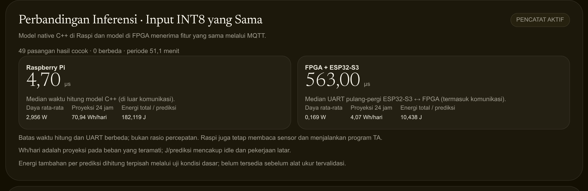<br/><sub>Dashboard: same INT8 input on the Raspberry Pi vs. the FPGA.</sub></td>
<td width="50%">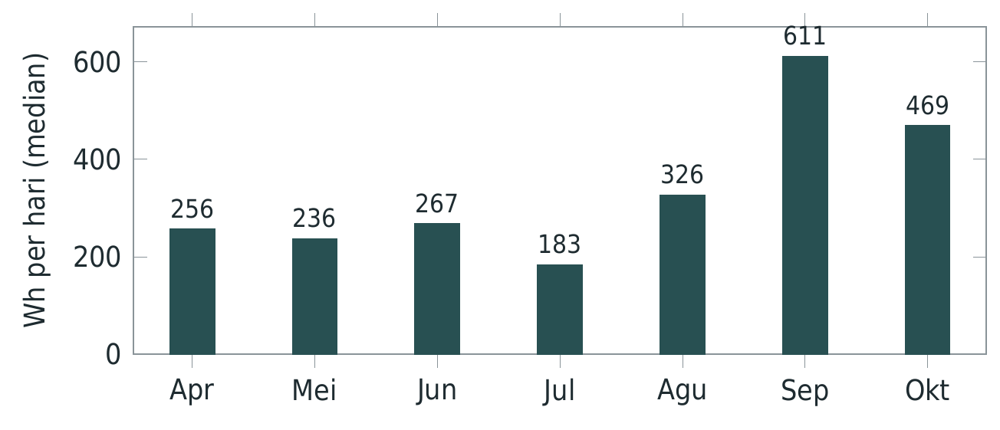<br/><sub>Median daily turbine energy per month (Apr–Oct 2026, 140 full days).</sub></td>
</tr>
<tr>
<td>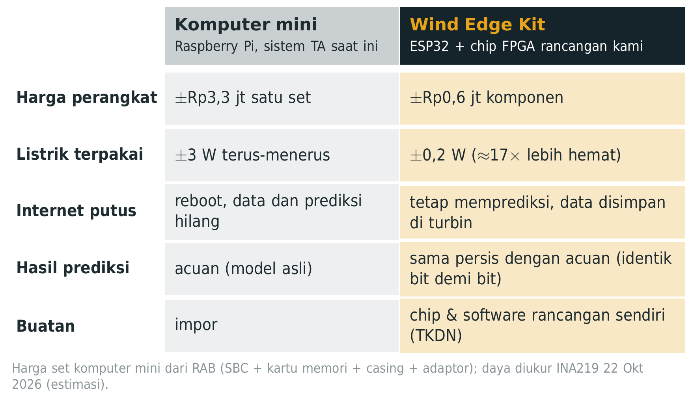<br/><sub>Mini computer vs. Wind Edge Kit.</sub></td>
<td>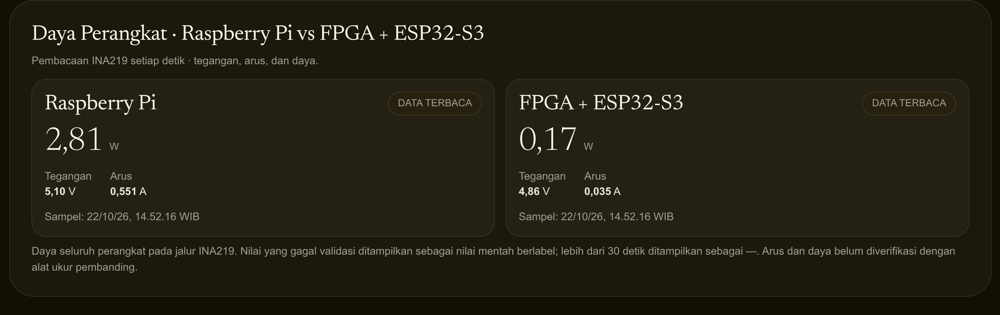<br/><sub>Live device-power panel (INA219).</sub></td>
</tr>
</table>

### Data

| Item | Value |
|---|---:|
| Raw rows (Raspberry Pi → Google Sheets / MQTT) | 2,218,464 |
| Clean rows | 2,209,408 |
| Minutes with data / total minutes | 181,228 / 293,661 (61.7 %) |
| Period (UTC) | 2026-03-30 → 2026-10-20 |
| Median daily energy (IQR) | 270.5 Wh (187.2–377.2) |

<sub>From [`ml/results/kualitas_data.json`](ml/results/kualitas_data.json) and [`energi_harian.json`](ml/results/energi_harian.json). The raw data is not stored in git; see [`data/README.md`](data/README.md).</sub>

## Quick start

```bash
git clone https://github.com/izmaherdian/wind-edge-chip-public.git && cd wind-edge-chip-public

# ML: train, quantise, export weights for the RTL
uv venv --python 3.12 ml/.venv
uv pip install --python ml/.venv -r ml/requirements.txt --index-strategy unsafe-best-match \
    --extra-index-url https://download.pytorch.org/whl/cpu
ml/.venv/bin/python ml/common/preprocess.py        # needs the raw CSV, see data/README.md
cd ml/forecast && ../.venv/bin/python train_mlp.py && ../.venv/bin/python export.py && cd ../..

# RTL: regression against the golden model (Icarus Verilog)
python3 hw/sim/run_regression_real.py

# Node-RED engine tests
node dashboard/wec/test/test_engine.js
node dashboard/wec/test/test_tanpa_pzem.js

# ESP32-S3 firmware (PlatformIO): copy secrets first
cp edge/esp32/include/secrets.example.h edge/esp32/include/secrets.h   # fill Wi-Fi + MQTT
```

The Python tools read the MQTT password from the `MQTT_PASS` environment variable. The InfluxDB credentials come from `~/.config/wind-edge-chip/influx.env`.

## Repository structure

```text
wind-edge-chip/
├── ml/            # preprocessing, 36-method benchmark, MLP INT8 QAT, golden model, results/
├── hw/            # Verilog RTL (MAC4 engine, FSM, UART), simulations, Tang Nano 4K build
├── edge/          # ESP32-S3 firmware, MQTT↔FPGA bridge, original TA Raspberry Pi programs
├── dashboard/     # Node-RED ML engine + hackathon page (wec/), InfluxDB (db/), TA flow (ta/)
├── measurements/  # power/latency logging, Raspberry Pi vs. FPGA comparison, results/
├── data/          # how to obtain the data (data itself is not in git)
└── docs/
    ├── demo/             # runbook, HIL log, wiring diagrams, system tests
    ├── laporan-progress/ # progress and ML reports (LaTeX + PDF)
    ├── presentasi/       # Beamer deck, Demo Day deck, figures, chart data
    ├── media/            # README GIFs
    └── kontrak-*.md      # UART and quantisation contracts
```

## Citation

```bibtex
@misc{windedgechip2026,
  title  = {Wind Edge Chip: One-Hour-Ahead Wind Power Forecasting on a Low-Power FPGA Accelerator},
  author = {Ekawati, Estiyanti and Argiliana, Shania and Herdian, Izma Alhazmi and
            Hartanto, Genis Gusvian and Rizky, Alif Muhammad},
  year   = {2026},
  note   = {DeepTech for Smart-X Hackathon 2026, Team Chitato},
  howpublished = {\url{https://github.com/izmaherdian/wind-edge-chip-public}}
}
```

## Authors

| Name | Role | Area |
|---|---|---|
| Estiyanti Ekawati | Supervisor (lecturer), ITB | Review |
| Shania Argiliana | PhD student, ITB | Proposal, business, measurements, reports |
| Izma Alhazmi Herdian | MSc student, ITB | ML model and integration (`ml/`) |
| Genis Gusvian Hartanto | PTIO ITB | Sensors, ESP32, dashboard, data (`edge/`, `dashboard/`, `data/`) |
| Alif Muhammad Rizky | BSc student, ITB | FPGA chip and FPGA–ESP32 link (`hw/`) |

This work builds on Genis Gusvian Hartanto's final-project (TA) wind-turbine monitoring system at CITA-ITB.

## License

No license has been chosen yet, so all rights are reserved by the authors.
