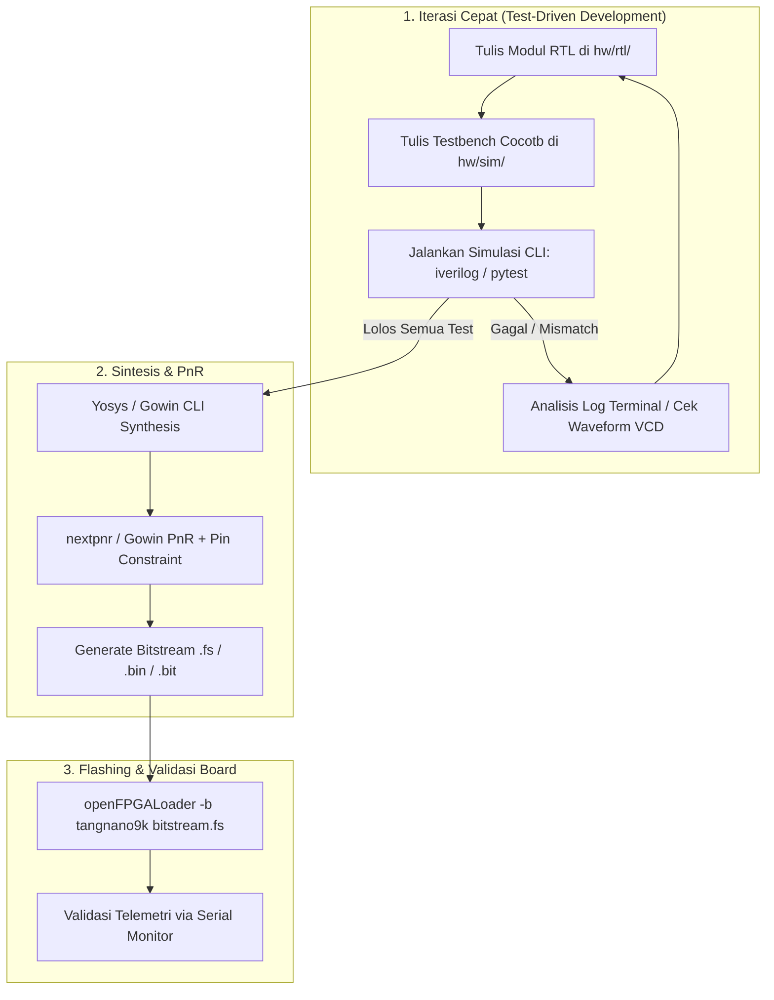

# hw/ (FPGA Edge Accelerator) — Architecture & Development Guide

Dokumen ini adalah panduan komprehensif perancangan, simulasi, sintesis, dan verifikasi modul FPGA pada proyek **WindEdgeChip**. Panduan ini dirancang dengan prinsip **Terminal/CLI-first**, **Automation-friendly**, dan **AI Coding Agent-ready**, sehingga baik developer manusia maupun Coding Agent dapat berkolaborasi secara seamless di VS Code tanpa ketergantungan wajib pada GUI vendor yang berat.

---

## 1. Studi Kasus & Dukungan Board Universal

### Studi Kasus Utama: **Sipeed Tang Nano 9K / 20K**
- **Chipset**: Gowin GW1NR-9 / GW2AR-18 (LittleBee / Arora Family).
- **Karakteristik**: Berbiaya sangat terjangkau (< Rp 300k - 500k), form factor ringkas, memiliki onboard USB-JTAG/UART (FTDI / BL702), dan didukung penuh oleh toolchain open-source modern (*Project Apicula*).
- **Skenario Proyek**: Akselerator inferensi edge (MAC engine / lightweight neural accelerator) yang berkomunikasi dengan ESP32/Host MCU via SPI / UART.

### Kompatibilitas Multi-Board Universal
Arsitektur kode RTL dan workflow pengujian dirancang vendor-agnostik:
- **Lattice iCE40** (iCEstick, Upduino) via `yosys` + `nextpnr-ice40` + `icepack`.
- **Lattice ECP5** (Colorlight i5/i9, OrangeCrab) via `yosys` + `nextpnr-ecp5` + `ecppack`.
- **Gowin** (Tang Nano 4K/9K/20K) via `yosys` + `nextpnr-gowin` + `gowin_pack` (Apicula) ATAU Gowin EDA CLI mode.
- **Xilinx / AMD** (Artix-7, Spartan-7, Basys 3, Arty A7) via Vivado Batch CLI (`vivado -mode batch -source build.tcl`).
- **Intel / Altera** (Cyclone IV/V, MAX10) via Quartus CLI (`quartus_sh`).

---

## 2. Struktur Direktori Rekomendasi (`hw/`)

```text
hw/
├── README.md                 <- Panduan ini
├── rtl/                      <- Kode Verilog/SystemVerilog murni (Vendor-Agnostic)
│   ├── top.v                 <- Top-level module
│   ├── mac_engine.v          <- Inti komputasi paralel MAC
│   ├── weight_buffer.v       <- Memori/BRAM buffer bobot model
│   ├── spi_slave.v           <- Komunikasi penerima Quad-SPI / SPI
│   └── uart_debug.v          <- Modul telemetri register/UART
├── sim/                      <- Testbench & Automasi Simulasi
│   ├── test_mac.py           <- Testbench Python (cocotb)
│   ├── Makefile              <- Make target untuk eksekusi simulasi
│   └── waveforms/            <- Output VCD/FST dump (diabaikan oleh git)
├── boards/                   <- Konfigurasi fisik spesifik board
│   ├── tang_nano_9k/
│   │   ├── tang_nano_9k.cst  <- Physical constraint (Gowin pinout)
│   │   └── Makefile          <- Script sintesis & pnr khusus Tang Nano 9K
│   ├── ecp5_colorlight/
│   │   └── colorlight.lpf    <- Pinout Lattice ECP5
│   └── arty_a7/
│       └── arty_a7.xdc       <- Pinout Xilinx Artix-7
└── scripts/                  <- Otomasi Agent & Flashing
    ├── build_gowin.py        <- Skrip wrapper kompilasi Gowin
    └── flash.py              <- Wrapper openFPGALoader
```

---

## 3. Prasyarat & Toolchain Requirements

### A. Environment Inti (Wajib untuk Semua Mesin)
1. **Python 3.10+**: Runtime untuk testbench cocotb dan script pembantu.
2. **Simulator RTL (Pilih salah satu / keduanya)**:
   - **Icarus Verilog (`iverilog`)**: Ringan, instalasi sangat cepat, cocok untuk functional testing & unit test cepat.
   - **Verilator**: Simulator performa tinggi berbasis C++ compilation, cocok untuk simulasi jutaan clock cycles.
3. **Cocotb & Pytest**:
   ```bash
   pip install cocotb pytest pytest-sugar
   ```
4. **openFPGALoader**: Tool CLI universal untuk flashing puluhan tipe board tanpa perlu GUI vendor.

### B. Toolchain Sintesis & PnR (Berdasarkan Tipe Alur Kerja)

#### Opsi 1: Open-Source Flow (Sangat Direkomendasikan untuk Agent)
- **Yosys**: Framework sintesis Verilog ke gate netlist.
- **nextpnr**: Place and Route engine (mendukung `nextpnr-ice40`, `nextpnr-ecp5`, `nextpnr-gowin`).
- **Project Apicula** (Khusus Gowin / Tang Nano):
  ```bash
  pip install apycula
  ```
- **Paket All-in-One CLI**: Tersedia melalui distribution package seperti **OSS CAD Suite** (YowASP atau YosysHQ OSS CAD Suite) yang sudah membundel Yosys, nextpnr, iverilog, openFPGALoader, dan Apicula dalam 1 folder portabel.

#### Opsi 2: Vendor Toolchain (Batch / Headless Mode)
- **Gowin EDA**: Menggunakan executable `gw_sh` di terminal untuk mengeksekusi script Tcl tanpa GUI.
- **AMD Vivado**: Menggunakan `vivado -mode batch -source build.tcl`.

### C. Ekstensi VS Code Rekomendasi
- `mshr-h.verilogHDL` atau `dan-c-underwood.systemverilog` (Syntax highlight, linter, formatting).
- `surfer-project.surfer` atau `wavetrace` (Menampilkan file `.vcd` / waveform langsung di dalam editor VS Code).

---

## 4. Alur Kerja Pengembangan (Workflow)



### Langkah 1: Menjalankan Simulasi & Verifikasi (Fase Agent)
Coding agent dapat memvalidasi modul secara mandiri tanpa memerlukan board fisik:
```bash
cd hw/sim
# Jalankan testbench cocotb
pytest -v test_mac.py
```
Jika terjadi kesalahan komputasi, agent membaca error assertion di terminal, merevisi logika Verilog di `hw/rtl/`, dan mengulangi perintah sampai semua test `PASSED`.

### Langkah 2: Inspeksi Gelombang Sinyal (Waveform Debugging)
Ketika testbench dijalankan, VCD dumper akan menghasilkan file trace:
- Buka file `hw/sim/waveforms/wave.vcd` langsung di VS Code menggunakan ekstensi **Surfer** atau **WaveTrace**.
- Periksa transisi clock, sinkronisasi valid/ready handshake, dan nilai bus data.

### Langkah 3: Sintesis & PnR (Build Bitstream)

#### Menggunakan Gowin EDA Batch CLI (Rekomendasi untuk Sipeed Tang Nano 4K):
```powershell
# Jalankan dari root direktori proyek:
& "C:\Gowin\Gowin_V1.9.12.04_x64\IDE\bin\gw_sh.exe" build_tang_nano_4k.tcl
```
Hasil sintesis dan routing bitstream biner tersimpan di:
* `impl/pnr/wind_edge_chip.fs` (ukuran $\approx 1{,}7\ \text{MB}$)

#### Menggunakan Open-Source Flow (Yosys + Apicula - Tang Nano 9K / 4K):
```bash
# 1. Sintesis RTL ke Netlist JSON
yosys -p "read_verilog hw/rtl/*.v; synth_gowin -json build/top.json"

# 2. Place and Route dengan pin constraint
nextpnr-gowin --json build/top.json \
              --write build/pnr_top.json \
              --device GW1NSR-LV4CQN48PC7/I6 \
              --family GW1NS-4 \
              --cst hw/boards/tang_nano_4k/tang_nano_4k.cst

# 3. Generate Bitstream
gowin_pack -d GW1NS-4 -o build/wind_edge_chip.fs build/pnr_top.json
```

---

### Langkah 4: Tata Cara Upload / Flashing ke Board

Gunakan **Gowin Programmer CLI** (atau `openFPGALoader`) untuk memprogram chip:

#### Opsi A: Upload ke SRAM (Volatile / Iterasi Pengujian Cepat)
* Bitstream langsung dieksekusi di FPGA dalam waktu $\approx 25\text{--}30$ detik.
* Cocok untuk pengetesan cepat selama proses coding. (Akan terhapus bila power/kabel dicabut).
```powershell
& "C:\Gowin\Gowin_V1.9.12.04_x64\Programmer\bin\programmer_cli.exe" `
    --device GW1NSR-4C `
    --operation_index 2 `
    --fsFile "C:\Users\ThinkPad\Documents\wind-edge-chip\impl\pnr\wind_edge_chip.fs"
```

#### Opsi B: Upload ke embFlash (Non-Volatile / Permanen)
* Menghapus dan menulis bitstream ke Embedded Flash internal FPGA ($\approx 100\text{--}110$ detik).
* **Permanen**: Ketika kabel power dicabut lalu dicolokkan kembali, FPGA akan otomatis *boot* dan menjalankan akselerator secara instan.
```powershell
& "C:\Gowin\Gowin_V1.9.12.04_x64\Programmer\bin\programmer_cli.exe" `
    --device GW1NSR-4C `
    --operation_index 5 `
    --fsFile "C:\Users\ThinkPad\Documents\wind-edge-chip\impl\pnr\wind_edge_chip.fs"
```

#### Opsi C: Menggunakan `openFPGALoader` (Multi-Platform / Linux / macOS)
```bash
# Flash ke SRAM (Volatile)
openFPGALoader -b tangnano4k -m impl/pnr/wind_edge_chip.fs

# Flash ke internal flash (Permanen)
openFPGALoader -b tangnano4k impl/pnr/wind_edge_chip.fs
```

---

## 5. Tata Cara Debugging & Telemetri Hardware

### 1. Simulasi Testbench (Pre-Silicon Verifikasi)
* Manfaatkan *Golden Model* di `ml/golden_model.py` sebagai referensi input-output biner. Testbench Python mengimpor model tersebut dan membandingkan output FPGA bit-demi-bit.
* Jalankan simulasi fungsional menyeluruh:
  ```bash
  python hw/sim/sim_uart_soc.py
  python hw/sim/run_regression.py
  ```

### 2. Hardware-in-the-Loop (HIL) Debugging via UART
Setelah bitstream berhasil di-flash ke FPGA, sambungkan PC / ESP32 ke pin UART Tang Nano 4K:
* **Pin 44**: UART RX (menerima 16 byte INT8 dari Host)
* **Pin 46**: UART TX (mengirim 3 byte respon ke Host)
* **Pin 14**: Tombol Reset S1 (*Active-Low*)
* **Pin 10 & 13**: LED Indikator (`led_busy` dan `led_done`)

Gunakan skrip HIL otomatis untuk memvalidasi respon inferensi hardware secara end-to-end:
```powershell
python hw/scripts/test_uart_hil.py --port COM13 --baud 115200 --samples 5
```

**Spesifikasi Paket UART Telemetri:**
* **Paket Kirim (16 Byte)**: `[fitur_0, fitur_1, ..., fitur_15]` (INT8 bertanda)
* **Paket Balasan (3 Byte)**:
  * `Byte 0`: Prediksi daya turbin (`signed INT8`)
  * `Byte 1`: Siklus clock MSB (`cycles[15:8]`)
  * `Byte 2`: Siklus clock LSB (`cycles[7:0]`)
  * Latensi riil pada 27 MHz: $\text{latency} = \frac{\text{cycles}}{27\times 10^6} \approx 11{,}48\ \mu\text{s}$ (310 siklus).

### 3. Pemecahan Masalah (Troubleshooting)
* **Lisensi Gowin EDA**: Pastikan file `C:\Gowin\Gowin_V1.9.12.04_x64\IDE\bin\gwlicense.ini` berisi `lic="106.55.34.119:10559"`.
* **Kabel Tidak Terdeteksi**: Jalankan `programmer_cli.exe --scan`. Pastikan driver FTDI Channel A (JTAG) dan Channel B (VCP) aktif di Device Manager.
* **FSM Macet**: Jika pengiriman paket terpotong (< 16 byte), tekan tombol **Key S1 (Pin 14)** untuk mereset FSM penerimaan.

Panduan khusus per-board dapat dilihat di [hw/boards/tang_nano_4k/README.md](file:///c:/Users/ThinkPad/Documents/wind-edge-chip/hw/boards/tang_nano_4k/README.md).

---

## 6. Checklist Kontribusi untuk Coding Agent
Saat agent diminta membuat modul atau fitur baru di `hw/`:
1. Jangan membuat logika sekuensial tanpa sinyal reset (`rst` / `rst_n`).
2. Pastikan file constraint pin (`.cst`, `.xdc`, atau `.lpf`) disesuaikan dengan skematik board.
3. Selalu sertakan file testbench di `hw/sim/` untuk modul baru.
4. Jangan melakukan commit file biner hasil kompilasi (`.fs`, `.bit`, `.json`, `.vcd`) ke git repository. Pastikan folder `hw/build/` dan `*.vcd` terdaftar di `.gitignore`.
