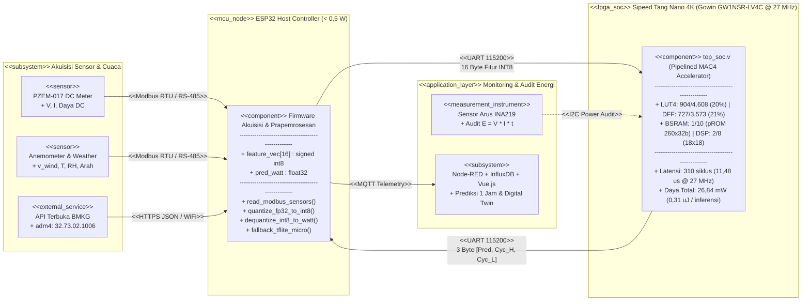
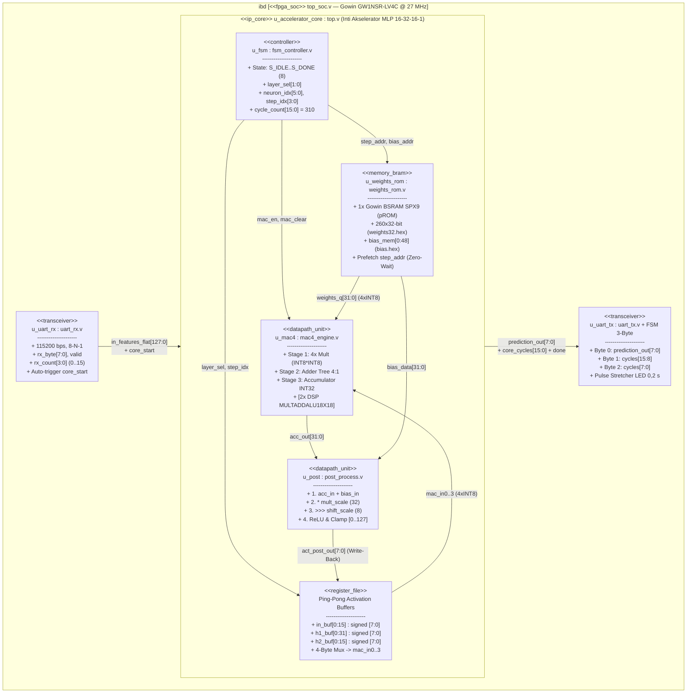
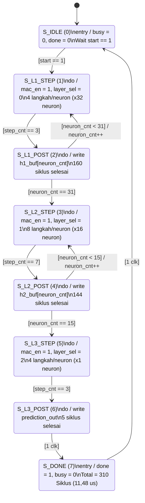

# Laporan Teknis Perancangan Arsitektur Perangkat Keras & Chip FPGA (*WindEdgeChip* — Sub-Proyek L3)

**Fokus Dokumen:** Peta Progres terhadap MVP (Dot-Line), Ringkasan Masalah, Ide Solusi Silikon, Diagram Blok Sistem & Chip Berstandar UML 2.5, Kondisi Arsitektur Eksisting, Rencana Improvisasi Chip, serta 3 Pertanyaan Mahasiswa kepada Mentor DeepTech.

---

## 1. Pembukaan: Posisi Capaian Program Chip Saat Ini

Laporan ini merangkum perancangan perangkat keras akselerator jaringan saraf tiruan pada papan FPGA **Sipeed Tang Nano 4K (Gowin GW1NSR-LV4C)** dalam proyek *WindEdgeChip*. Diagram garis progres (*dot-line timeline*) di bawah ini memetakan posisi kode *Register-Transfer Level* (RTL) yang telah selesai diprogram saat ini terhadap standar *Minimum Viable Product* (MVP) dan rencana pengembangannya:

```
========================================================================================================
   PETA GARIS PROGRES (DOT-LINE TIMELINE): POSISI PROGRAM CHIP SEKARANG TERHADAP MVP & IMPROVISASI
========================================================================================================

                              [BATAS SYARAT MVP]
                                      |
  TAHAP 1             TAHAP 2         |     POSISI SEKARANG             TAHAP 4              TAHAP 5
 (Selesai)           (Selesai)        |  (MVP Inti Tercapai!)       (Penguatan MVP)      (Melebihi MVP)
                                      |
    (1)=================(2)===========|=========[ (3) ]=================(4)------------------(5)
     |                   |            |            |                     |                    |
     v                   v            |            v                     v                    v
+----------+       +-----------+      |     +--------------+       +------------+       +------------+
| Golden   |       | 6 Modul   |      |     | Flash Fisik  |       | Hardening  |       | Improvisasi|
| Model AI |       | RTL Murni |      |     | Tang Nano 4K |       | Protokol   |       | Lanjut     |
| INT8/32  |       | 2.000 Uji |      |     | 20% LUT      |       | 0xAA+CRC8  |       | Quad-SPI   |
| weights32|       | 100% Match|      |     | 26,84 mW     |       | Watchdog & |       | BSRAM RAM  |
| .hex     |       | Simulasi  |      |     | 310 clk HIL  |       | Uji INA219 |       | Getaran/IC |
+----------+       +-----------+      |     +--------------+       +------------+       +------------+
```

Mengacu pada syarat MVP Lapisan 3 (tersedianya desain sirkuit terpadu/*IP Core* yang teruji fungsional beserta profil daya dan latensi), **program chip yang kami bangun saat ini (Titik 3) sudah memenuhi syarat MVP perangkat keras**. Seluruh modul RTL telah disintesis, ditanamkan ke memori *embFlash* FPGA, dan diuji secara fisik melalui *Hardware-in-the-Loop* (HIL). Oleh karena itu, tahapan kerja selanjutnya difokuskan pada **penyempurnaan ketahanan protokol sistem (Titik 4)** dan **pengembangan fitur tambahan di luar MVP (Titik 5)** dengan memanfaatkan sekitar 80% kapasitas logika FPGA yang masih tersedia.

---

## 2. Ringkasan Masalah

Turbin angin skala mikro di lingkungan perkotaan menghadapi aliran udara yang sangat fluktuatif akibat halangan bangunan. Secara aerodinamika, daya mekanis turbin berbanding lurus dengan pangkat tiga kecepatan angin ($P = \frac{1}{2}\rho A v^3 C_p$). Berdasarkan rekaman data 11 bulan di Gedung PAU ITB, kenaikan kecepatan angin dari $2{,}05\text{ m/s}$ menjadi $3{,}80\text{ m/s}$ ($1{,}85\times$) menaikkan daya keluaran dari $5{,}6\text{ W}$ menjadi $158{,}7\text{ W}$ (**$28\times$ lipat**). Tanpa prediksi daya satu jam ke depan, pengelola mikrogrid kesulitan mengatur penyimpanan baterai dan pencadangan beban, sehingga energi turbin saat ini masih dibuang ke resistor beban (*dump load*). Penerapan model prediksi langsung pada perangkat tepi (*edge*) menghadapi empat kendala perangkat keras:

1. **Konsumsi Daya Statis Komputer Mini yang Tidak Proporsional:** Sistem pemantauan terdahulu menggunakan Raspberry Pi 4 Model B. Meski rata-rata utilisasi CPU hanya $\sim 2\%$ dan RAM $\sim 8\%$, perangkat tersebut tetap menyerap daya **$3\text{--}5\text{ Watt}$** secara terus-menerus. Saat angin lemah dan turbin hanya menghasilkan $5\text{--}10\text{ W}$, sebagian besar energi habis dikonsumsi oleh perangkat pemantaunya sendiri.
2. **Inefisiensi Siklus Instruksi Berurutan (*Von Neumann*):** Prosesor umum mengeksekusi instruksi satu per satu melalui tahapan *fetch-decode-execute*. Untuk jaringan saraf dengan ribuan operasi perkalian-akumulasi (MAC), siklus waktu dan energi banyak terbuang pada lalu lintas bus instruksi.
3. **Keterbatasan Ruang untuk Prosesor Lunak (*Soft-Core CPU*) pada FPGA Kecil:** Pendekatan seperti *CFU Playground* menanamkan prosesor RISC-V di dalam FPGA. Namun, pada FPGA berkapasitas kecil ($4.000\text{--}5.000\text{ LUT}$), prosesor lunak tersebut menyita lebih dari $70\%$ gerbang logika, sehingga menyisakan ruang yang sempit untuk unit akselerator.
4. **Risiko Ketergantungan Koneksi Cloud:** Pengiriman data mentah ke server eksternal rentan terputus saat gangguan jaringan, sedangkan pengendalian pembangkit membutuhkan waktu respons yang pasti (*deterministic latency*) di lokasi.

---

## 3. Ide Solusi: Arsitektur Heterogen dan Akselerator MAC4

Kami memisahkan tugas komunikasi dan tugas komputasi matriks ke dalam dua perangkat keras yang bekerja berdampingan:

* **ESP32 sebagai Pengendali I/O dan Prapemrosesan ($< 0{,}5\text{ W}$):** Membaca sensor arus-tegangan PZEM-017 dan stasiun cuaca melalui Modbus RTU (RS-485), mengambil data cuaca BMKG, menyusun 16 fitur masukan, mengkuantisasinya ke format bilangan bulat 8-bit bertanda (*signed INT8*), lalu mengirimkan hasilnya ke dashboard melalui MQTT.
* **FPGA Sipeed Tang Nano 4K (`Gowin GW1NSR-LV4C`) sebagai Ko-Prosesor Inferensi:** Menjalankan modul **Standalone Pipelined MAC4 Engine** yang dirancang langsung pada tingkat gerbang logika (RTL) tanpa bantuan prosesor lunak. Empat jalur perkalian-akumulasi bekerja paralel di bawah kendali mesin status terbatas (FSM), sehingga seluruh jaringan saraf selesai dihitung secara deterministik dengan daya puluhan miliwatt.

| Paradigma Arsitektur | Mekanisme Eksekusi | Keunggulan Utama | Keterbatasan pada Edge Kecil |
| :--- | :--- | :--- | :--- |
| **1. Soft-Core RISC-V + CFU** | Menanam CPU lunak (VexRiscv) di FPGA ditambah instruksi kustom. | Fleksibel; pemrograman berbasis C/C++. | CPU lunak menyita $>70\%$ LUT FPGA kecil; percepatan terbatas. |
| **2. Systolic Array (TPU-like)** | Kisi 2D unit pemroses (PE) yang mengalirkan data antar-tetangga. | Throughput tinggi untuk matriks berdimensi besar. | Penjadwalan rumit; utilisasi rendah pada vektor kecil ($N = 16$). |
| **3. Recurrent Engine (LSTM)** | Sirkuit sekuensial dengan tabel pencari (LUT) fungsi $\tanh$/$\sigma$. | Menangkap memori urutan waktu secara intrinsik. | Galat aproksimasi non-linier; boros area logika dan blok DSP. |
| **4. Standalone Pipelined MAC4 (Desain Kami)** | Jalur pipa 4 pengali paralel + pohon penjumlah yang diatur FSM. | **Tanpa beban CPU; hemat area logika (20% LUT) dan daya.** | Topologi terikat jadwal FSM; perubahan layer butuh sintesis ulang. |

---

## 4. Diagram Blok Sistem dan Chip Berstandar UML 2.5

Spesifikasi antarmuka antara subsistem mikrokontroler (`edge/`), model pembelajaran mesin (`ml/`), dan perangkat keras FPGA (`hw/`) didokumentasikan menggunakan standar **Unified Modeling Language (UML 2.5)** pada tiga tingkat abstraksi:

### 4.1 UML Component Diagram: Arsitektur Sistem Terintegrasi



### 4.2 UML Composite Structure / Internal Block Diagram (IBD): Arsitektur Internal Chip (`top_soc.v`)



### 4.3 UML State Machine Diagram: Kendali Urutan Eksekusi (`fsm_controller.v`)

Setiap neuron diproses melalui siklus perkalian-akumulasi (4 siklus pada Lapisan 1 dan 3; 8 siklus pada Lapisan 2) ditambah 1 siklus pasca-pemrosesan (`POST`). Total eksekusi seluruh jaringan selalu konstan pada **310 siklus clock** ($160 + 144 + 5 + 1$).



---

## 5. Arsitektur Chip Eksisting, Evaluasi MVP, dan Rencana Improvisasi

### 5.1 Kondisi Arsitektur Chip yang Sudah Diprogram Saat Ini (*Existing RTL*)

Implementasi RTL saat ini terdiri atas enam berkas Verilog (IEEE 1364-2001) di direktori [`hw/rtl/`](file:///c:/Users/ThinkPad/Documents/wind-edge-chip/hw/rtl) yang dikelompokkan ke dalam tiga fungsi utama:

1. **Antarmuka Serial Berkecepatan Tinggi & Pengemas Paket Berbingkai ([`top_soc.v`](file:///c:/Users/ThinkPad/Documents/wind-edge-chip/hw/rtl/top_soc.v), [`uart_rx.v`](file:///c:/Users/ThinkPad/Documents/wind-edge-chip/hw/rtl/uart_rx.v), [`uart_tx.v`](file:///c:/Users/ThinkPad/Documents/wind-edge-chip/hw/rtl/uart_tx.v)):** Beroperasi pada clock kristal **27 MHz** dengan laju UART berkecepatan tinggi **921.600 bps (8-N-1)**, memangkas waktu transmisi dari ~1,65 ms menjadi hanya **~206 μs (8× lebih cepat)**. Protokol mengadopsi bingkai paket (*packet framing*) 19-byte **[0xAA, 0x55, 16 Byte Fitur INT8, CRC-8]** dengan proteksi kesalahan perangkat keras **CRC-8 CCITT (Polinomial 0x07, Inisialisasi 0x00)** dan *Watchdog Timeout* (10 ms). Jika paket korup atau terputus di tengah, FSM otomatis kembali ke `WAIT_SYNC1` dan mengirim kode status `0xE1` tanpa memproses data sampah. Saat komputasi selesai, modul membalas dengan paket berbingkai 7-byte: **[0x55, 0xAA, STATUS (0x00), PREDIKSI, CYC_MSB, CYC_LSB, CRC-8]**.
2. **Memori Bobot BSRAM 32-Bit dengan *Prefetch* Alamat ([`weights_rom.v`](file:///c:/Users/ThinkPad/Documents/wind-edge-chip/hw/rtl/weights_rom.v), [`top.v`](file:///c:/Users/ThinkPad/Documents/wind-edge-chip/hw/rtl/top.v)):** Sebanyak 1.040 bobot INT8 dikemas menjadi 260 kata 32-bit (`weights32.hex`) di dalam satu blok memori keras **Gowin BSRAM SPX9** (mode `pROM`). Untuk mengimbangi latensi baca BSRAM sebesar 1 siklus clock, penunjuk alamat *prefetch* (`step_addr`) dimajukan satu siklus lebih awal saat sinyal `start` aktif, sehingga 4 bobot INT8 dapat diumpankan ke pengali setiap siklus tanpa jeda (*zero wait-state*).
3. **Jalur Hitung MAC4 ([`mac4_engine.v`](file:///c:/Users/ThinkPad/Documents/wind-edge-chip/hw/rtl/mac4_engine.v)) dan Pasca-Pemrosesan ([`post_process.v`](file:///c:/Users/ThinkPad/Documents/wind-edge-chip/hw/rtl/post_process.v)):** Empat pasang aktivasi dan bobot INT8 dikalikan secara paralel dan dijumlahkan ke akumulator 32-bit. Pada siklus akhir tiap neuron, hasil akumulasi ditambahkan dengan bias 32-bit (`bias.hex`), dikalikan faktor skala tetap (`mult_scale = 32`), digeser ke kanan 8-bit (`>>> 8`), melewati fungsi aktivasi ReLU, dan dibatasi pada rentang $[0, +127]$.

| Sumber Daya / Parameter | Pemakaian Aktual | Persentase / Nilai | Peran dalam Arsitektur Eksisting |
| :--- | :--- | :---: | :--- |
| **Gerbang Logika (LUT4 + ALU)** | `1.091 / 4.608` unit (1.014 LUT, 77 ALU) | **24%** | Logika FSM, kalkulator CRC-8 hardware, watchdog, dan UART 921.6k. |
| **Register Flip-Flop (DFF)** | `773 / 3.573` register (0 Latch) | **22%** | Buffer masukan, register framing FSM, dan akumulator. |
| **Embedded Block SRAM (BSRAM)** | `1 / 10` blok (Mode `pROM` SPX9) | **10%** | Memori bobot $260\times 32\text{-bit}$ (mengeluarkan 4 bobot INT8 per siklus). |
| **Blok DSP (`MULTADDALU18X18`)** | `2 / 8` unit pengali keras | **25%** | Unit perkalian paralel MAC4 dan pengali skala pasca-proses. |
| **Waktu Eksekusi & Latensi** | `310` siklus clock @ 27 MHz | **11,48 μs** | L1: 160 siklus, L2: 144 siklus, L3: 5 siklus, DONE: 1 siklus. |
| **Round-Trip Latency Total** | 19B RX (204 μs) + Hitung (11,48 μs) + 7B TX (75 μs) | **290,74 μs** | **7,8× lebih cepat** dibanding legacy 115.2k (2.264 μs); throughput ~3.440 pkt/s. |
| **Konsumsi Daya & Energi** | Statis: 26,02 mW \| Dinamis: 0,85 mW | **26,87 mW** | Energi inferensi $\approx 0{,}31\text{ }\mu\text{J}$ per prediksi ($>110\times$ lebih rendah dari Raspi 4). |
| **Pinout Fisik QFN48P (LVCMOS18)** | `clk`:45 \| `rst_n`:14 \| `rx`:44 \| `tx`:46 | **6 / 39 I/O (16%)** | Pin 10: `led_busy` (Active-Low), Pin 13: `led_done`, UART 921600 bps. |

### 5.2 Evaluasi terhadap MVP dan Rencana Penyempurnaan

Secara fungsionalitas perangkat keras inti (L3), **program yang ada sekarang telah memenuhi target MVP secara andal**: seluruh perhitungan berjalan di atas silikon fisik Tang Nano 4K, komunikasi serial telah diproteksi penuh oleh bingkai paket dan CRC-8, serta laju baudrate telah diakselerasi ke 921.600 bps. Adapun fokus penyempurnaan berikutnya meliputi:

* **Parameter Skala Kuantisasi Masih Seragam:** Nilai `mult_scale = 32` masih disamakan untuk semua lapisan, dan neuron keluaran masih melewati pemotongan ReLU positif.
* **Bobot Model Bersifat Statis di *pROM*:** Pembaruan bobot hasil pelatihan ulang masih memerlukan sintesis dan *flashing* ulang bitstream FPGA.

### 5.3 Rencana Improvisasi Chip Selanjutnya

Dengan sisa kapasitas logika yang masih sangat leluasa (76% LUT dan 90% BSRAM), rencana pengembangan dipetakan pada tabel berikut:

| Tahapan | Fokus Improvisasi | Implementasi RTL dan Manfaat di Lapangan |
| :--- | :--- | :--- |
| **Tahap A: Penguatan MVP Sistem** | **1. Framing Paket (`0xAA`/`0x55`), CRC-8, & 921.6 kbps UART** | **[SELESAI & LOLOS AUDIT]** Paket 19B berbingkai + CRC-8 hardware menolak paket korup (status 0xE1); baudrate 921600 bps memangkas latensi transfer dari 1,65 ms ke 206 μs. |
| **Tahap A: Penguatan MVP Sistem** | **2. Skala Kuantisasi Per-Lapisan (*Per-Layer Scale*)** | Menambahkan multiplexer `mult_scale[layer_sel]` untuk tiap lapisan serta opsi melewati ReLU (*linear bypass*) pada lapisan output ke-3 guna menjaga presisi regresi. |
| **Tahap B: Pengembangan Melebihi MVP (*Beyond MVP*)** | **3. Pembaruan Bobot via UART (*Writable BSRAM*)** | Mengubah konfigurasi BSRAM dari `pROM` menjadi **Dual-Port SRAM** sehingga ESP32 dapat memperbarui bobot model di lapangan melalui paket khusus (header `0xBB`) tanpa *re-flashing*. |
| **Tahap B: Pengembangan Melebihi MVP (*Beyond MVP*)** | **4. Antarmuka SPI Cepat & *Clock-Gating*** | Menambahkan jalur SPI Slave untuk memangkas waktu transfer data menjadi $<10\text{ }\mu\text{s}$ dan mematikan sinyal clock ke `mac4_engine` saat status `IDLE` untuk menekan daya dinamis. |
| **Tahap B: Pengembangan Melebihi MVP (*Beyond MVP*)** | **5. Analisis Getaran Turbin & Sintesis ASIC** | Memanfaatkan sisa LUT dan DSP kosong untuk memproses sinyal getaran mekanis bantalan turbin (deteksi anomali dini), serta memetakan RTL ke alur **OpenLane + SkyWater SKY130 (130 nm)**. |

---

## 6. Daftar Pertanyaan kepada Mentor DeepTech (Perspektif Mahasiswa terhadap Realitas Lapangan)

Sebagai mahasiswa yang mengembangkan purwarupa ini di lingkungan laboratorium kampus, kami ingin memahami kondisi operasional yang sesungguhnya di industri. Berikut adalah tiga pertanyaan yang ingin kami diskusikan bersama Mentor:

### 6.1 Pertanyaan 1: Perangkat Eksisting, Kendala, dan Kebutuhan Riil di Lapangan Saat Ini
> *"Sejauh ini pengalaman kami masih terbatas pada pengamatan turbin angin skala kecil di lingkungan kampus yang sebelumnya dipantau menggunakan Raspberry Pi. Kami ingin bertanya kepada Bapak/Ibu Mentor: pada instalasi pembangkit energi terbarukan atau mikrogrid di lapangan saat ini, perangkat pemroses dan pengontrol apa yang sebenarnya paling umum digunakan? Apa kendala utama dari perangkat yang dipakai sekarang, dan fitur atau kemampuan apa yang paling dibutuhkan oleh operator di lapangan?"*

### 6.2 Pertanyaan 2: Kecukupan Solusi Sederhana vs. Kebutuhan Penggunaan FPGA di Lapangan
> *"Dalam proyek ini kami merancang akselerator pada chip FPGA untuk mendampingi mikrokontroler dalam memprediksi daya secara cepat dan hemat energi. Menurut pandangan Bapak/Ibu Mentor, jika melihat dinamika masalah di lapangan saat ini, apakah kebutuhan pemantauan dan prediksi daya sebenarnya sudah cukup diselesaikan dengan pendekatan yang lebih sederhana—seperti mikrokontroler standar atau PLC industri—ataukah memang terdapat kondisi kasus lapangan tertentu yang menuntut penggunaan perangkat keras tingkat lanjut seperti FPGA ini?"*

### 6.3 Pertanyaan 3: Prioritas Pengembangan Perangkat Keras untuk Menghadapi Kondisi Lapangan
> *"Saat ini desain inti pada FPGA kami sudah berjalan memenuhi fungsi dasar (MVP) dan masih menyisakan sekitar 80% kapasitas chip yang kosong. Mengingat kondisi lingkungan lapangan yang berat—mulai dari derau kelistrikan generator, fluktuasi catu daya, cuaca ekstrem, hingga perubahan karakteristik mekanis turbin seiring waktu—menurut pengalaman Bapak/Ibu Mentor, bagian mana yang sebaiknya menjadi prioritas improvisasi perangkat keras kami agar sistem ini benar-benar andal saat diterapkan di lapangan?"*
